<picture>
  <source media="(prefers-color-scheme: dark)" srcset="https://raw.githubusercontent.com/FarahBaseet/FarahBaseet/main/dist/pet.svg">
  <source media="(prefers-color-scheme: light)" srcset="https://raw.githubusercontent.com/FarahBaseet/FarahBaseet/main/dist/pet-light.svg">
  
</picture>

<picture>
  <source media="(prefers-color-scheme: dark)" srcset="https://raw.githubusercontent.com/FarahBaseet/FarahBaseet/main/dist/graph.svg">
  <source media="(prefers-color-scheme: light)" srcset="https://raw.githubusercontent.com/FarahBaseet/FarahBaseet/main/dist/graph-light.svg">
  
</picture>

A personal portfolio built with React, Vite, and custom CSS. It is a static site
with no backend and can be deployed to GitHub Pages.

## Run locally

```sh
npm ci
npm run dev
```

Create a production build with `npm run build`; preview it locally with
`npm run preview`. The static output is written to `dist/`.

## GitHub Pages

The workflow in `.github/workflows/deploy.yml` builds and deploys the site when
changes are pushed to `main`. In the repository settings, set **Pages → Build
and deployment → Source** to **GitHub Actions**.

Vite uses relative asset paths so the same build works at a project-page URL or
a custom domain. Update the bio, project details, and links in `src/App.jsx`.
